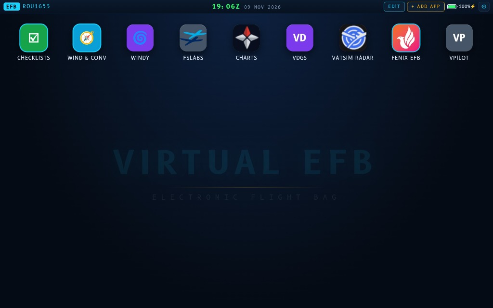

# Virtual EFB (Electronic Flight Bag)

An open-source Electronic Flight Bag designed for flight simulator enthusiasts (Microsoft Flight Simulator, X-Plane, Prepar3D).

Virtual EFB runs as a **standalone, full-screen Android tablet application** paired with a lightweight **PC companion server** that automatically syncs your custom apps, settings, and aircraft `.pdf` checklists two-way over your local home Wi-Fi.



---

## Highlights & Features

### ✈️ Cockpit Design & Avionics Aesthetic
* **Cockpit Theme**: Sleek, high-contrast dark cockpit aesthetic utilizing **B612**—the open-source font designed for aircraft cockpit displays.
* **Status Bar**: Real-time **UTC (Zulu) clock**, live date, battery monitor, night-dimming slider, and screen wake-lock toggle.

### ✈️ SimBrief & Navigraph Flight Integration
* **Callsign Sync**: Enter your **SimBrief Pilot ID** (or username) in the **Settings** (⚙) tab and tap **FETCH** to pull through your active OFP callsign directly into the top-left of the EFB header.
* **Wind & Conversions Active Flight Banner**: In the **Wind & Conv** app, an active flight banner displays your route (e.g. `EGKK → EIDW`). Tapping the **`↻`** (Refresh) button next to the flight details pulls through your latest SimBrief flight plan, updates your top-left callsign, and automatically imports all Navigraph departure and arrival runway magnetic headings with one-tap `DEP` and `ARR` loading.

### 📱 Dedicated Android Tablet Application
* **Standalone Android APK**: Runs completely full-screen with immersive mode enabled. Includes an AssistiveTouch / iPad-style floating home button that can be freely dragged anywhere on the screen.
* **Native In-App Browsing**: Embedded web views allow external flight tools to load cleanly without browser chrome or toolbars.
* **Zero PC Requirement in Cockpit**: All flight tools, cached checklists, and flight calculators run directly on the tablet.

### 📋 Interactive Checklists & Local Wi-Fi Sync
* **Built-in PDF Viewer**: Render multi-page aircraft procedures and checklists with night-mode inverted reading and auto-fit scaling.
* **Two-Way Local Wi-Fi Sync**: Drop `.pdf` checklists directly into the PC's `checklists/` folder and `Virtual-EFB.exe` automatically indexes and syncs them to both `localhost:8088` and your tablet over Wi-Fi.
* **Offline Caching**: All opened checklists are cached permanently on the tablet—fly even when your PC is turned off.
* **Direct Import**: Add PDFs directly from your tablet storage via the `+ ADD CHECKLIST` file picker.

### 🧭 Wind Components, METAR & Live D-ATIS
* **Runway Wind Vectors**: Enter an ICAO airport code to load runways, calculate headwind, tailwind, and crosswind components, and highlight the optimal runway.
* **Live VATSIM & Real-World D-ATIS**: Automatically pulls digital ATIS from active VATSIM controllers. When no controller is online, it falls back to real-world Digital ATIS (both Arrival and Departure ATIS) using a native Android bridge that bypasses CORS restrictions. Displays the ATIS issue time, flags 2–6 hour old reports as stale, and hides cached D-ATIS older than 6 hours so it does not conflict with live METARs.
* **Conversion Tools**: Instant conversions for Fuel (KG, LBS, US Gal, Litres), Weight, Pressure (hPa ↔ inHg), and Distance/Speed.

---

## When is the PC Companion Server Needed?

The PC server (`Start-EFB.bat` / `Virtual-EFB.exe`) does **not** need to run continuously while you fly:
* **First-Time Setup**: Used once to download `EFB.apk` to your tablet over local Wi-Fi and establish the initial connection.
* **Checklist Syncing**: Only needed when you drop new `.pdf` checklist files into your PC's `checklists/` folder and want to sync them to your tablet. Once opened, all checklists are cached permanently on your tablet.
* **Two-Way App & Settings Sync**: Add, edit, reorder, or remove custom apps—or update SimBrief/display settings—on either your PC (`http://localhost:8088/`) or your tablet, and changes persist across refreshes and sync automatically when connected (`data/state.json`).
* **While Flying**: You can safely close the PC server. The Android tablet runs completely standalone in the cockpit.

> [!WARNING]
> **Web Browser Limitations vs. Dedicated Android App**
> While the EFB can be opened in any desktop web browser (`http://localhost:8088/`), **not all features will work in a web browser**:
> 1. **Blocked Iframe Embedding**: Many popular flight simulation web services (e.g., Navigraph Charts, live VATSIM radars, flight tracking tools) block embedding inside desktop browser iframes via `X-Frame-Options` and `CSP` security headers. The dedicated Android tablet app runs a custom native view that bypasses frame blocking.
> 2. **CORS Restrictions**: Real-world Digital ATIS (D-ATIS) and certain flight data feeds are blocked by desktop browser cross-origin (CORS) security policies. The Android app includes a native bridge (`EFBNative`) that bypasses CORS restrictions directly.
> 3. For full functionality, the standalone Android app (**`EFB.apk`**) is strongly recommended.

---

## Quick Start Guide

### Step 1: Set Up the PC Sync Server (For Checklists)
1. Download this project onto your simulator PC:
   * Click the green **Code** button at the top of the repository and select **[Download ZIP](../../archive/refs/heads/main.zip)** (or download the **Source code (zip)** from the [Releases](../../releases) tab).
2. Extract the `.zip` archive anywhere on your PC (e.g., `C:\Virtual-EFB` or in your Documents folder).
3. Drop your aircraft `.pdf` checklist files directly into the extracted `checklists/` folder (they are indexed automatically).
4. Double-click **`Start-EFB.bat`** (or **`Virtual-EFB.exe`**):
   * The EFB web interface will open directly in your browser (`http://localhost:8088/`), and the local Wi-Fi sync server will start in the background.
   * *(Note: Always launch using `Start-EFB.bat` or `Virtual-EFB.exe` rather than double-clicking `index.html` directly. The server is only required for initial setup, syncing new checklists from your PC, or configuring apps via localhost—once cached, the PC server does not need to stay running while you fly).*

### Step 2: Install the App on your Android Tablet (Over Local Wi-Fi)
1. On your Android tablet, open any web browser (Chrome, Samsung Internet, Firefox).
2. Type your PC's download address directly into the tablet's browser:
   ```text
   http://<YOUR-PC-IP>:8088/EFB.apk
   ```
   *(For example, if your PC screen shows `192.168.1.50`, type `http://192.168.1.50:8088/EFB.apk`)*.
3. Your tablet will immediately pull the installer file directly from your PC!
4. Open the downloaded file using Android's **Package Installer** and tap **Install**.
   *(If prompted by Android, tap "Allow from this source" or "Install anyway").*
5. Launch **EFB** from your tablet's home screen.

*(Alternative: You can also download `EFB.apk` directly from the [Releases](../../releases) tab on GitHub).*

### Step 3: Connect Tablet to PC (One-Time Setup)
1. In the **EFB** app on your tablet, tap ⚙ **Settings** on the top bar.
2. Under **Simulator PC Connection**, enter the IP:Port shown on your PC screen (e.g., `192.168.1.50:8088` — or just the IP, which defaults to `:8088`) and tap **CONNECT**.
3. All checklists from your PC's `checklists/` folder will immediately sync to your tablet over your home Wi-Fi!

### Step 4: Link SimBrief (Optional)
1. Tap ⚙ **Settings** on the top bar.
2. In the **SIMBRIEF PILOT ID** field, enter your numeric Pilot ID (or SimBrief username) and tap **FETCH**.
3. Your active OFP callsign will immediately appear in the top-left of the EFB header.
4. Open the **Wind & Conv** app and tap the **`↻`** (Refresh) button: it will pull through your current callsign, departure airport, and arrival airport, automatically loading the runways and Navigraph magnetic headings.

---

## Adding & Customizing Apps

Tap **+ ADD APP** on the top bar of either your tablet or PC (`http://localhost:8088/`):
* **Web Address**: Enter any flight simulation URL (e.g., Navigraph Charts, VATSIM Radar, Windy, SimBrief, SkyVector).
* **HTML File**: Select any single-file HTML web utility saved on your device.
* **Custom Icons**: Choose from 10 cockpit highlight colors and custom letter/emoji icons or upload an image.
* **Reorder & Edit**: Long-press any tile (or tap **EDIT**) to move, reconfigure, or delete tiles.
* **Two-Way Sync**: Changes made on either your PC or your tablet are saved on your PC (`data/state.json`) and automatically sync across refreshes and devices.

---

## Building the APK from Source

The repository includes an automated build script that compiles `EFB.apk` using the Android Command-Line Tools without requiring Android Studio:

### Prerequisites
* Windows 10/11
* Java JDK 17+ (`winget install EclipseAdoptium.Temurin.17.JDK`)
* Android Command-Line Tools & SDK Platform 34 (`platforms;android-34`, `build-tools;34.0.0`)

### Build Command
Run from the repository root:
```powershell
powershell -ExecutionPolicy Bypass -File android\build.ps1
```
The compiled, aligned, and signed `EFB.apk` will be output directly to the root directory.

---

## Directory Structure

```text
├── EFB.apk                 # Pre-built standalone Android app installer
├── Virtual-EFB.exe         # Companion web server & Wi-Fi sync engine
├── Start-EFB.bat           # 1-click launcher for the PC web version & sync server
├── preview.jpg             # Application interface preview
├── index.html              # EFB launcher UI (bundled inside the Android app)
├── css/                    # Cockpit theme styling
├── js/                     # EFB app state and local sync engine
├── apps/                   # Bundled utilities (Checklists, Wind Calc, Windy)
├── checklists/             # Drop your aircraft PDF checklists here
├── data/                   # Runway heading corrections & synced app/settings state (state.json)
├── vendor/                 # Bundled runway database & PDF.js library
├── android/                # Native Android application source & build scripts
└── tools/                  # Companion server and background sync utilities
```

---

## License

This project is open-source under the [MIT License](LICENSE).
Cockpit font **B612** is licensed under the SIL Open Font License (OFL).
